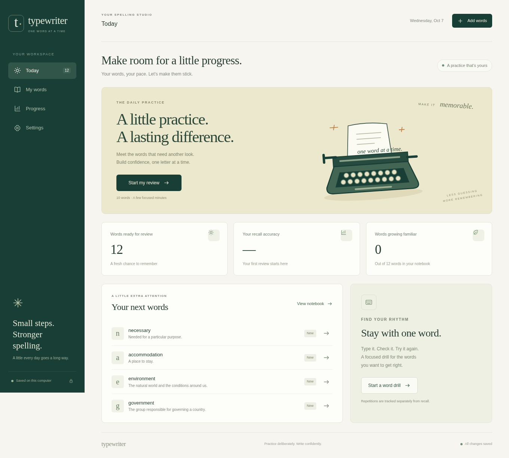

# Typewriter

A local spelling practice app for words you actually struggle with.

Write an essay, collect its spelling mistakes, and turn them into a personal word
notebook. Practise with sentence clues, meanings, pronunciation, or repeated typing
drills. Typewriter remembers your progress and brings difficult words back for review.



## Start the app

You'll need Python 3.10 or newer.

```bash
python3 -m venv .venv
source .venv/bin/activate
pip install -r requirements.txt
python app.py
```

Open **http://127.0.0.1:8080** in your browser. On Windows, activate the environment
with `.venv\Scripts\activate` instead.

For an application-menu entry on Pop!_OS or Linux:

```bash
python3 desktop/install.py
```

The launcher starts Typewriter in the background and reuses the running instance.
Closing the browser tab leaves the server running. To stop it, use the launcher's
**Stop Typewriter** action or run `python3 desktop/launch.py --stop`.

Install **FFmpeg** for consistent pronunciation loudness. On Pop!_OS/Ubuntu:

```bash
sudo apt install ffmpeg
```

The app remains usable without it; recordings then play at their original levels.

## Build your notebook

Add words yourself, look them up in Cambridge, or collect misspellings from Essay
Studio. Essay words can wait in a manual or LLM preparation queue until their clues
are ready. Existing words can be marked for another review when you misspell them in
an essay, without turning that mistake into a quiz score.

Meanings, examples, spelling tips, and pronunciations stay editable. You can prepare
material with Gemini, or export prompts for any LLM and import its reply without an
API key. Manual practice needs neither service. Flag unclear clues to improve them
in a later preparation batch.

The spelling checker works offline, accepts British and American spellings, and has
a personal dictionary for names and specialist words. Essay text is saved locally;
list continuation and Tab indentation help with outlines without changing spellings.

## Practise your way

Reviews use all due words by default, with an optional session limit or endless mode.
Choose the exercises and quiz spacing in Settings. Drills, hints, meaning quizzes,
and unaided spelling reviews keep separate statistics.

Legacy uses fixed review stages; optional FSRS adapts spelling-review dates. You can
preview a scheduler change and switch back later. [How reviews are selected](docs/review-ranking.md)
explains the details.

Pronunciations come from several dictionary sources, or your own uploads. Compare
voices in a list and choose one to keep. Automatic selections for the LLM queue are
labelled and remain unchecked for audio-only exercises until you review them.
Settings control playback volume, sound at the start of each exercise, and sound
after an answer. Optional local [typing measurements](docs/typing-confidence.md)
can collect experimental timing summaries without changing grades or scheduling.

## Optional services and privacy

Gemini keys can be entered in Settings or in a local `api_keys.txt`, one per line.
Preparation batches words and rotates keys while respecting configurable request
limits. Keys from the same Google project still share its provider quota.

HTTP and SOCKS5 proxies are configurable in Settings. Dictionary searches, downloads,
and API requests use the selected route; disabling it means a direct connection.

Your words, essay, settings, history, and audio cache live in **`data/`**. Export a
notebook backup from Settings, or copy the whole folder to keep recordings as well.
Keys, credentials, and personal data are excluded from Git. The server listens only
on your own computer; this is a personal app rather than a hosted multi-user service.

The [user guide](docs/user-guide.md) covers preparation, backups, keyboard controls,
and troubleshooting. [Memory measurements](docs/memory-usage.md) describe the resource
checks and their limits. Dictionary parsing began with ideas from
[AnkiAutomata](https://github.com/SMani24/AnkiAutomata); Typewriter runs independently.
With both apps open, **Open in AnkiAutomata** sends a word and sentence for card
review. AnkiAutomata can send reviewed words back without overwriting duplicates.
See the [integration guide](docs/user-guide.md#ankiautomata-integration) for details.

## Development checks

```bash
python -m unittest discover -s tests -v
npm install
npx playwright install chromium
npm test
```

Browser checks use temporary notebooks and synthetic audio. Node is needed only for
these checks, not for running Typewriter.
