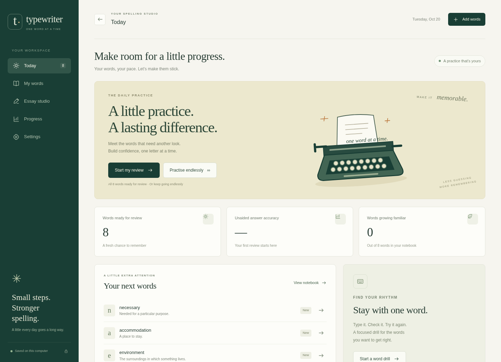
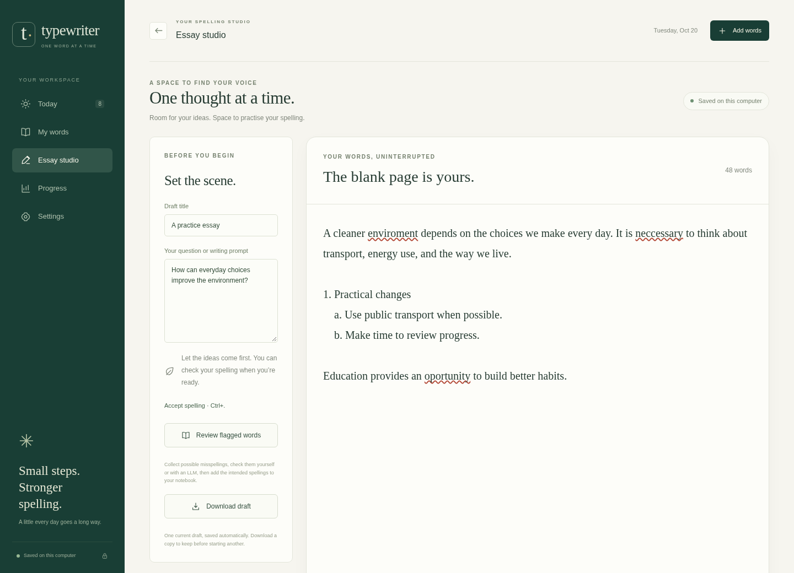

# Typewriter

## Product, current capabilities, and website launch options

**Investor discussion briefing · 20 October 2026** 
**Product snapshot:** `147c3da78c8f4000573b7e97284b1d234d3a37bd` 
**Stage:** working personal-use prototype; hosted product proposed 
**Purpose:** establish a shared picture of what exists and invite direction on what to build and validate next.

> Turn the spelling mistakes you make in writing into words you can recall later.

Typewriter began with an IELTS writing-preparation problem: knowing a word does not necessarily mean being able to spell it reliably when writing independently. The product connects a learner's own writing to a personal vocabulary notebook, focused exercises, and future reviews.

A substantial learning workflow already runs locally in a browser. A public website, customer accounts, subscriptions, and a commercially validated learning service have not yet been built. This briefing distinguishes those states throughout. The next decision is which audience and delivery model to validate, followed by a scoped hosted pilot—not an assumption that every possible feature belongs in the launch.

**Reading guide:** Sections 1–4 explain the product and demonstrate the experience. Sections 5–8 explain its learning logic, content, engineering, and evidence. Sections 9–14 outline the website transition, commercial hypotheses, validation plan, and decisions requested. Appendix A links the underlying implementation.

[TOC]

## 1. The opportunity being explored

### The learner's problem

Spelling correction can help someone finish a piece of writing without establishing whether they can reproduce the word correctly tomorrow. Learners may also keep informal word lists, repeat familiar words because they are easy to practise, or struggle to assemble useful definitions, examples, and pronunciation recordings for their actual mistakes.

Typewriter addresses a specific workflow gap: **capture a mistake from real writing, check the intended word, prepare useful practice material, and return to that word later.** This is the product hypothesis behind the implementation; demand at market scale has not been established.

The initial use case is independent spelling practice for English learners preparing for IELTS writing. The current app does not grade essays, predict IELTS bands, assess grammar or argument quality, or provide a complete exam-preparation curriculum. Its usefulness for those wider goals would require separate product development and evaluation.

### Initial audience hypotheses

| Audience | Possible need | What still needs to be learned |
| --- | --- | --- |
| IELTS learners practising independently | Turn recurring writing mistakes into a manageable review routine | Whether spelling is a sufficiently important unmet problem to drive repeat use and payment |
| English learners outside exam preparation | Build reliable spelling for personally relevant vocabulary | Whether the same workflow is useful without an exam deadline |
| Tutors and small language programmes | Give learners targeted follow-up between writing sessions | Whether teachers will assign it, what progress information they need, and who pays |

These are proposed segments, not existing customer groups or evidence of partnerships. The founder's own use case informed development; it does not establish representative demand.

## 2. Product proposition and learning loop

Typewriter combines five steps in one personal workspace:

**Write → Check and collect → Prepare → Practise → Return for review**

1. **Write:** draft an essay in a focused editor with optional spelling underlines.
2. **Check and collect:** review suggested mistakes and confirm the intended spellings. The original essay remains unchanged.
3. **Prepare:** attach a meaning, example, spelling tip, and suitable pronunciation manually or with optional external assistance.
4. **Practise:** type from a sentence, definition, or recording; answer a meaning quiz; or deliberately repeat one difficult word.
5. **Return:** use recorded performance and review dates to select future practice rather than repeatedly choosing only comfortable words.

The notebook belongs to the learner's actual writing. Incorrect clues and recordings can be flagged and repaired. Repetition, hints, and immediate corrections are kept distinct from independent spelling answers, so activity does not automatically become evidence of mastery.

### A representative journey

A learner writes “neccessary” in Essay Studio. Typewriter flags the spelling but does not rewrite it. The learner confirms “necessary,” chooses a preparation route, and checks the resulting material. A review can later ask for the missing word in a sentence or supply a meaning or recording as its clue. If the learner struggles, the app offers correction practice and retains the difficulty for future review selection.

If the correct word is already in the notebook, confirming the essay mistake creates a separate reminder for review. It does not invent a failed quiz answer or overwrite the learner's existing material. This distinction matters when presenting progress honestly.

## 3. Current product: what is implemented

**Status terms used in this report**

- **Implemented:** present in the inspected application code; the feature is part of the current local product.
- **Experimental:** implemented measurement infrastructure whose educational interpretation is not validated.
- **Proposed:** a candidate next step for discussion; no delivery commitment is implied.
- **Not established:** evidence or an operational capability was not available in this review.

### Capability inventory

| Area | Implemented capability | Present boundary |
| --- | --- | --- |
| Personal word notebook | Individual and bulk entry; editable meanings, examples, tips, tags, and pronunciations; search and selected-word actions | One local notebook, without hosted account ownership or automatic cross-device synchronisation |
| Essay Studio | Local autosave, word count, optional offline spelling flags, personal dictionary, plain-text outlines, nested lists and indentation, draft download | One current draft; spelling support rather than grammar, essay marking, or a writing curriculum |
| Mistake-to-word intake | Confirm intended spellings; discard false flags or accept a spelling; choose manual or LLM preparation; queued flags leave the review list | A suggestion needs learner review; a flag is not automatically a correct diagnosis or a graded learning event |
| Preparation queues | Keep unfinished words outside practice; activate manual material or prepare with an LLM | Content readiness and quality still depend on usable clues and user checks |
| Spelling exercises | Type from sentence context, a meaning, or checked audio; reveal spelling or practise a correction | Available exercises depend on the material saved for each word |
| Meaning reviews | Multiple-choice meanings, generated distractors when available, immediate number-key answers | Meaning scores are separate; independent meaning-review scheduling is not implemented |
| Focused drills | Repeat the same word for a target or without a target; searchable picker with completion | Drill success is deliberate practice, not proof of later independent recall |
| Review sessions | Due-word reviews, selected-word practice, configurable length, and endless practice; configurable fixed or random quiz intervals | A local notebook supports one active server-tracked practice session at a time |
| Scheduling | Default Legacy scheduling and optional FSRS; preview and reversible switching; separate stored states | No demonstrated Typewriter-specific retention uplift or optimised personalised model |
| Pronunciation | UK/US preferences, exact-word source matching, voice comparison, uploads, incorrect-audio flags, volume and autoplay controls | Source availability and recording quality vary; hosted distribution needs a content-sourcing decision |
| Progress | Answer history, unaided-answer measures, separate drill and meaning activity, recurring difficulty signals | These are learner practice statistics, not a validated proficiency or IELTS score |
| Portability | Notebook export/import, older-format compatibility, migration backups, retained history | Uploaded recordings are not embedded in JSON exports; full local-data transfer is needed to carry those files |
| Accessibility-oriented controls | Keyboard review flow, selectable text sizes, responsive layouts, collapsible navigation, replay shortcuts | A formal accessibility audit and a broad device/browser certification have not been completed |
| Operational controls | Configurable network routing, request budgets, batching, provider failure handling, local diagnostics | Designed for personal operation; these are not yet a hosted operations platform |

The current default review length is **all due eligible words**, with a configurable shorter limit. An older saved screenshot or narrative reference to a ten-word default should not be used to describe the current configuration. [S1–S7]

### What “runs in a browser” means today

The interface is web-based, but the Python server and SQLite notebook run on the user's computer. A Linux launcher can open it like an application. There is no installation-free, public multi-user service in the inspected implementation.

Cached and manually prepared exercises can be used without generating AI requests. New online dictionary searches, recording downloads, and API preparation require their respective services. An installable offline website and automatic cloud synchronisation are separate proposed capabilities.

## 4. A look at the current experience

*Figure 1. Current daily-practice screen, captured for this report using a disposable notebook. All vocabulary and counts are illustrative demo data, not customer, revenue, engagement, or learning-outcome metrics.*

*Figure 2. Current Essay Studio with a synthetic essay. Flags invite review without silently correcting the draft. No personal writing or API keys were used to produce these images.*

The existing visual direction uses a quiet writing workspace, restrained colours, readable typography, and keyboard-friendly interaction. The website can build on this interface, while validating mobile input, accessibility, onboarding, and behaviour on additional browsers.

## 5. How practice and personalisation work

### Accuracy is the primary recorded evidence

Typewriter records answers and their context: exercise, hints, session type, correctness, timing, and scheduling decisions. Meaning quizzes, drills, assisted corrections, and independent spelling reviews are treated differently. More repetitions can increase activity without increasing the independent-recall evidence used for scheduling.

### Two selectable spelling schedulers

**Legacy** uses fixed review stages and prioritises recent qualified difficulty, the latest struggle, and overdue words. Due successes can advance a stage; extra successful practice does not keep postponing future reviews. Failed or hinted spelling reviews return sooner. A regular oldest-due selection provides opportunities for neglected words.

**FSRS** is an optional integration using the pinned Py-FSRS library. It updates spelling-memory state from qualifying due reviews. Users can preview how changing the active scheduler affects current workload, then switch while retaining both engines' states and the original answer history.

The 90% FSRS retention setting is a scheduler configuration target—not an observed retention rate for Typewriter users. The app does not claim a measured exam-score improvement. Switching engines also does not demonstrate that one is better for this audience. [S3, S4]

### Drill recommendations and quiz rhythm

Recurring mistakes and recent struggle can suggest a focused drill. Successful drilling temporarily reduces that word's drill priority while leaving recall grades and review dates intact. Meaning quizzes have configurable frequency, including a randomly sampled interval range, but do not train the spelling scheduler.

This gives the product an adaptive practice routine today without requiring the proposed typing-behaviour research to succeed.

### Typing behaviour: infrastructure exists; further work is on hold

An optional, default-off experiment can retain aggregate latency, edit, pause, interruption, and audio-context measurements for eligible spelling attempts. It retains no new keystroke transcript or draft text. Collection can be disabled, and saved summaries can be deleted without deleting the word or answer history.

It does **not** produce a confidence score, classify a motor slip as a knowledge failure, diagnose difficult letter segments, or change scheduling. Text latency still includes reading; device, input method, fatigue, and interruption effects remain important limitations.

**Further research, predictive modelling, insights, and scheduling integration are on hold for this discussion.** They are possible later directions, not prerequisites for a website pilot or promised launch features. Predictive usefulness and improved learning have not been demonstrated. [S8]

## 6. Content preparation and AI's role

Typewriter's core loop can work with manually entered material. AI is an optional preparation assistant rather than a requirement for every practice session.

| Route | Current behaviour | Website implication |
| --- | --- | --- |
| Manual | The learner supplies and edits meanings, examples, tips, and audio | Supports a low-dependency pilot and preserves an editing fallback |
| Dictionary-assisted | Source lookups can supply meanings, examples, and candidate recordings | Commercial sourcing, attribution, availability, and content quality need a launch decision |
| Gemini API | Batched generation; configurable budgets and pacing; multiple configured keys, cooldowns, error reporting, and manual retries | A hosted product needs a service-level cost model and quota controls rather than relying on personal keys |
| Bring another LLM | Export uniquely identified prompt batches, then validate and import the reply; choose words per file | Gives users an alternative without an app-managed generation call, but adds manual steps and external sharing chosen by the user |
| Repair and re-evaluation | Flag poor meanings, examples, quiz options, or pronunciation; prepare flagged material or explicitly re-evaluate selected words | Content quality and repair effort should be measured during a pilot |

Ordinary preparation protects existing material and newer manual edits. Generated content is checked for structure and basic suitability, including usable example sentences. Those checks do not guarantee semantic accuracy, pedagogical quality, or a correctly matched pronunciation.

Recorded source and attribution information are useful implementation foundations. **Commercial permission for hosting publisher definitions, examples, and recordings has not been established by this review.** No negotiated content agreement is evidenced in the repository. The launch team needs to decide what it will license, generate, accept from users, or omit before distributing a hosted content library.

Key rotation is a failure-handling mechanism, not proof of additional provider capacity or a substitute for a commercial service plan. No provider-price, quota-capacity, or production cost claim is made here. [S5, S6, S9]

## 7. Engineering foundation

### Current architecture

The browser interface uses HTML, CSS, and JavaScript. A Python/Flask application handles notebook operations, practice sessions, content preparation, and external requests. SQLite holds the local notebook, history, settings, and scheduling state; audio files and playback derivatives live on disk. FFmpeg optionally adjusts playback loudness while preserving original recordings.

External services are accessed through a common network layer, with explicit HTTP/SOCKS proxy settings for the personal application. Preparation and voice work use in-process background workers. Existing protection includes same-origin checks, a request token for changes, restrictive browser content policies, input validation, private audio caching, and diagnostic messages designed to avoid logging notebook contents or credentials.

These choices make a self-contained local app practical. They do not establish identity, account ownership, or separation between internet users. [S2, S5–S7, S9]

### Reusable assets

- The writing-to-practice journey and much of the existing interface.
- Exercise eligibility, correction handling, keyboard interactions, and feedback.
- Word/history data structures, both spelling schedulers, and backup/version handling.
- Optional content-preparation adapters and repair workflows.
- Automated backend and browser checks, synthetic fixtures, and privacy-aware diagnostics.

### Boundaries that affect hosting

The current data model does not assign each word, essay, history row, recording, or setting to an authenticated account. There is one current essay per notebook, shared notebook settings, and one active practice-session guard per notebook. Sharing that notebook unchanged among customers would mix their data and block independent sessions.

The application entry point binds to localhost and uses Flask's built-in application runner. Background workers and coordination are tied to a running process. The page's request token is also process-specific. Simply changing the listen address or placing the current server behind a public URL would not create a suitable multi-user product.

A hosted implementation needs an explicit workspace boundary and a production deployment design. A private pilot might use rigorously isolated personal stores; a larger service might use a server database with enforced account ownership. The choice should follow the pilot's scope and operations needs. An immediate wholesale rewrite is not assumed, but unchanged shared local storage is not an acceptable user boundary.

## 8. What is evidenced—and what is not

### Engineering evidence available

The 19 October 2026 implementation record reports **211 passing backend tests** and a passing complete JavaScript/browser runner. Coverage includes scheduling, retries, backups, essay recovery, exercise controls, audio, and typing-measurement invariants. This is regression evidence, not proof of educational benefit.

Browser checks use disposable notebooks, synthetic material, and disabled external-provider calls; some test real browser decoding of synthetic recordings. They do not establish continuing dictionary availability or generated-clue quality. Separate 200-word local resource checks distinguish browser-driver effects from application behaviour; they are not concurrent-user or cloud-capacity tests. [S8, S10, S11]

**Report preparation on 20 October:** source and documentation were inspected and two synthetic current-interface screenshots were generated. The application regression suites were not rerun for this documentation-only report. The totals above are the recorded 19 October results.

### Evidence still needed

| Question | Current evidence position |
| --- | --- |
| Do learners want this workflow enough to keep using it? | No representative acquisition or retention cohort was supplied |
| Does it improve later independent spelling? | No controlled Typewriter learning-outcome study was supplied |
| Does it improve IELTS writing scores? | Not demonstrated; the app does not score the full writing task |
| Will customers pay, and at what price? | No verified paid conversion, revenue, or price experiment was supplied |
| Is the market large enough for the intended business? | No market-sizing study or validated addressable segment is included |
| Is the approach commercially differentiated? | No systematic competitor benchmark or defensibility study was supplied |
| Will hosting scale economically? | No multi-user capacity test or measured hosted cost per learner exists in the inspected evidence |
| Is it ready for a public security/accessibility review? | Local safeguards and tests exist; formal hosted security and accessibility assessments remain to be done |

Personal notebooks and synthetic demo counts should not be presented as traction. The existing test suite should not be presented as evidence of educational efficacy.

## 9. From personal prototype to a website

**Proposed launch objective:** let a learner sign in, build a private notebook from their writing, complete a useful first practice session, and return on another device with progress preserved.

The following is a workstream proposal for discussion, not an agreed implementation contract or calendar estimate.

| Workstream | Minimum outcome for a hosted pilot | Release evidence |
| --- | --- | --- |
| Identity and private workspaces | Sign-in, account lifecycle, and ownership for vocabulary, essays, histories, settings, recordings, exports, and jobs | Two accounts cannot read or modify one another's objects, including guessed IDs and downloads |
| Storage and migration | Durable user data, owned media storage, migrations, backups, and a tested path from a local notebook | Restore exercise and migration rehearsal preserve material, answer history, and both scheduler states |
| Server operation | Production serving, secure transport, controlled configuration, deployment rollback, health checks, and monitoring | A release/rollback drill and a bounded pilot-load test succeed without data mixing or lost accepted answers |
| Background preparation | Durable, owned jobs; controlled concurrency; retry/idempotency; cancellation and visible failure status | Restarting or retrying a job does not create duplicate charges or silently overwrite newer material |
| AI and cost control | Chosen provider/key ownership, per-account usage limits, service-wide budgets, and observed cost reporting | One account cannot exhaust the pilot's entire budget; failed work is understandable and recoverable |
| Content and pronunciation | An agreed permitted source strategy, attribution handling, quality checks, and a manual fallback | The pilot can operate with its approved material sources and trace the origin of supplied content |
| Privacy and data lifecycle | Clear collection/sharing choices, retention and deletion behaviour, export, and restricted diagnostic access | A user export/deletion exercise is completed; optional research data remains separately controllable |
| Browser and input experience | Usable onboarding and practice across the chosen devices, keyboard/touch input, and accessibility checks | Pilot-critical journeys pass on the agreed browser/device matrix with keyboard access and readable layouts |
| Commercial and support flow | A supported onboarding path, help/issue handling, and a chosen way to test payment if included | A new learner can reach first value, recover from a content failure, and understand any purchase terms |

The pilot should have a defined size and operating limits. Reliability and cost thresholds should be set before release, then tested against that scope rather than implying unlimited capacity.

### Hosted privacy is a separate design decision

The current local storage story changes when an operator hosts essays and learning histories. The website will need to explain what it stores, which optional actions send vocabulary or excerpts to a provider, who can access diagnostics, how deletion works, and what remains in backups. Requirements for the chosen audience and jurisdictions need a dedicated review; no compliance certification is claimed here.

The current personal-proxy settings also need redesign. A server cannot automatically use a learner's laptop proxy at its localhost address. Hosted outbound access should be operator-controlled and restricted rather than exposing arbitrary connection settings to every account.

### Candidate pilot scope

A focused first website could retain personal notebooks, a basic writing-to-word flow, one polished review journey, clear progress, export, and reliable content repair. Keep both implemented scheduler choices available with clear defaults and migration tests. Include AI only where it helps activation enough to justify its cost and quality burden.

Multi-user launch work should take priority over expanding experimental personalisation. Multiple saved essays, reminders, a teacher dashboard, new exam modules, and detailed behavioural insights can be evaluated after the initial audience and routine are validated.

## 10. Potential differentiation and its limits

The strongest current product story is the connected workflow: personal writing mistakes become checked, editable learning material, then deliberate practice and future independent reviews. The learner has control over clue quality and pronunciation instead of having to accept a bad exercise indefinitely.

This suggests three positioning hypotheses:

1. **Personal relevance:** practise the spellings that appear in your own writing.
2. **Continuity:** correction is the start of a learning task, not the end of a document edit.
3. **Honest progress:** assisted practice, immediate repetition, and independent answers are visibly different kinds of activity.

These are descriptions of the intended experience, not verified competitive advantages. Before making uniqueness claims, compare the full journey against users' actual alternatives: their current correction tools, flashcard routines, tutoring, and informal notes. The practical benchmark is time to useful practice and a sustained learning routine, not the number of features on a comparison chart.

The current implementation uses established software and an external scheduling library. No patented algorithm, exclusive dataset, publisher partnership, or proven data advantage is established by this report. Trustworthy content, effective onboarding, distribution, and demonstrated learning value would need to be earned. Optional behavioural data might support future research only with consent, sufficient follow-up, and evidence that it adds useful information.

## 11. Business-model options to test

No business model or pricing level is validated. The following alternatives are discussion hypotheses rather than revenue forecasts.

| Option | Possible offer | Why consider it | What could invalidate it |
| --- | --- | --- | --- |
| Individual subscription | A hosted private notebook, synchronisation, convenient preparation, and sustained practice support | Closely matches the independent learner's current workflow | Low willingness to pay, exam-driven churn, or service costs exceeding a sustainable price |
| Limited free tier with paid convenience | A useful entry experience, with paid capacity or preparation/service features | Allows learners to experience the loop before payment | Most users receive enough value free, or limits prevent meaningful activation |
| Tutor/programme plan | Assigned practice, learner workspaces, and appropriate teacher visibility | Could connect writing feedback to between-session practice | Requires a distinct teacher product, longer sales cycles, permissions, and support that the current app does not provide |
| User-supplied AI access | Hosted learning workflow while learners use their own provider or exported prompts | May reduce operator-funded generation in an early test | Too much setup friction, inconsistent experience, or support costs; it is not a complete unit-economics strategy |

The report does not recommend a price, fundraising amount, valuation, paid-provider plan, or hosting commitment. These should follow audience research, measured service costs, and a decision about the intended business.

### Unit economics to measure in a pilot

Track contribution from a paying learner against payment fees and the service costs attributable to serving them: generation, content access, audio processing/delivery, storage, application operation, and support. Distinguish one-time word preparation from repeated practice using saved material.

Useful operational denominators include cost per prepared word, cost per activated learner, storage/media growth per retained learner, and support effort per active learner. Record failed/retried generation and content repair as real work. Assess customer acquisition costs separately from serving costs. The app's batching and caching are useful controls, but savings and margins have not been measured for a hosted cohort.

## 12. Product and learning validation plan

### Start with a narrow pilot question

**Can a defined group of learners repeatedly turn their own writing mistakes into useful practice, then spell those words independently after a meaningful delay?**

Establish the audience, recruitment channel, pilot duration, consent, budget cap, and success/stop criteria before recruitment. Do not choose thresholds after seeing favourable results. A small usability pilot can identify friction; it cannot establish a general learning effect by itself.

| Measurement | Proposed definition | Interpretation safeguard |
| --- | --- | --- |
| Activation | Learner adds or confirms personally relevant words, obtains usable clues, and completes the first unaided spelling session | Account creation alone is not activation |
| Time to first value | Time from starting onboarding to that first useful session | Separate provider waiting time, content repair, and setup problems |
| Return behaviour | Cohort-based return to eligible practice on later days/weeks | Report dropouts and exam deadlines rather than showing only engaged survivors |
| Delayed spelling | First eligible unaided spelling outcome after a defined delay, adjusted or stratified by exercise and actual spacing | Do not substitute copying, drills, hinted answers, or same-session correction |
| Transfer to writing | Recurrence of confirmed spelling errors in later comparable writing tasks | Writing topics and opportunities to use each word differ; avoid comparing raw error totals without context |
| Content quality | Proportion of prepared words usable without correction; reasons for flags; time to repair | Successful JSON import is not a quality score |
| Reliability and cost | Saved-answer integrity, failures, preparation delay, observed usage cost, support demand | Report failure cases and operating limits, not only average response time |
| Willingness to pay | A clearly defined price/offer experiment with a real decision or transaction when appropriate | Interview enthusiasm is not paid conversion or predictable revenue |

Commercial analytics for this cohort are proposed work. The local app's answer history is useful, but it is not an existing acquisition funnel, cross-account analytics service, or representative customer dataset.

### Evaluation sequence

Begin with observed problem and usability discovery, then run a bounded hosted pilot. Evaluate learning separately using a predeclared delayed-spelling target and a suitable comparison design. Account for dropouts, assistance, exercise type, spacing, and repeated practice; seek study-design expertise before making efficacy claims. Reconsider typing research only with adequate consent, follow-up, and evidence of additional predictive value. Website launch does not depend on a confidence model.

## 13. Proposed milestones and decision gates

| Gate | Deliverable | Evidence to proceed | Possible decision if evidence is weak |
| --- | --- | --- | --- |
| A. Choose the problem and customer | Agreed primary segment, interviews/observations, pilot question, and a concise offer | Learners demonstrate a recurring problem and can explain the product's value in their own terms | Narrow the use case, change the audience, or stop adding features |
| B. Prepare a private hosted pilot | Account isolation, durable data/jobs, a permitted content plan, essential operations, and a tested release scope | Private-workspace checks, restore rehearsal, supported journeys, and budget controls pass | Reduce pilot scope or resolve a foundational blocker before invitations |
| C. Test the routine | A bounded cohort with defined activation and return metrics | Usability and repeat use meet predeclared criteria, with acceptable content/support cost | Simplify onboarding, change preparation strategy, or reconsider the product proposition |
| D. Test a commercial offer | Selected pricing/package experiment and cost reporting | Real willingness to pay and a plausible serving-cost structure | Change the offer, channel, or delivery model; avoid scaling an unproven funnel |
| E. Expand selectively | Prioritised features or research based on cohort evidence | Each extension addresses a measured need and has an owner, success criterion, and operating budget | Defer speculative features, including behavioural personalisation |

No delivery dates or effort estimates are committed. The team, capacity, procurement choices, content strategy, and pilot scope must be known before a credible schedule or budget can be produced.

## 14. Direction requested from potential investors

The most useful next contribution is direction on the following decisions, with reasons and evidence required—not simply a longer feature list.

| Decision | Options to discuss | Desired output |
| --- | --- | --- |
| Initial customer | IELTS-focused independent learner, broader English learner, or tutor-led programme | One primary audience and recruitment route for the first pilot |
| Product promise | Spelling habit from personal writing, exam-oriented practice support, or tutor follow-up | A concise promise that the current or scoped pilot product can deliver |
| Delivery scope | Tightly bounded private website pilot, a more fully managed service, or continued local validation first | A release boundary and explicit exclusions |
| Content strategy | Permitted/licensed dictionary material, generated material with checks, user/teacher material, or a controlled mix | A sourcing owner and a diligence plan before hosted distribution |
| AI service model | Operator-funded preparation, capped usage, optional personal access, manual material, or exported prompts | A chosen pilot experience and a measurable cost ceiling |
| Commercial test | Individual payment, limited free access, tutor/programme offer, or an initial research/usability cohort | The next experiment; no invented revenue forecast |
| Evidence standard | Usability/return behaviour first, a formal learning-outcome study, or both in sequence | Metrics, comparison approach, and proceed/stop criteria agreed in advance |
| Resources and governance | Engineering, design, teaching/content, research, operations, and support responsibilities | Named owners and a basis for later effort and budget estimates |
| Research posture | Keep typing research paused, or consider a separately scoped future study | A recorded decision that does not silently expand the website launch scope |

### Information needed before a formal investment case

This product review does not establish the founding team and contributor commitments, ownership/distribution terms, commercial content agreements, customer pipeline, geography, market size, pricing, revenue, acquisition economics, financial runway, funding requirement, or valuation. The owner should provide those inputs separately if the discussion moves from product direction to financing.

No root-level application licence file was found in the inspected snapshot. Third-party spelling resources include provenance and notices, and dependencies/content sources have their own terms. An ownership and distribution review remains an explicit pre-launch task; this briefing does not resolve it.

**The immediate decision:** choose a primary learner, a narrow hosted-pilot scope, a content approach, and the evidence required to justify the next investment of work.

## Appendix A. Evidence and source map

This briefing is based on the public repository's implementation and documentation at the product snapshot above. Strategic options are the report's proposals. No market study, paid customer dataset, private notebook, investor commitment, commercial agreement, or external legal/security audit was used.

| Ref | Repository evidence | Supports |
| --- | --- | --- |
| S1 | [README](https://github.com/SMani24/Typewriter/blob/147c3da/README.md); [user guide](https://github.com/SMani24/Typewriter/blob/147c3da/docs/user-guide.md) | Product workflow, local operation, preparation, practice, backups, and controls |
| S2 | [app.py](https://github.com/SMani24/Typewriter/blob/147c3da/app.py); [web routes and local protections](https://github.com/SMani24/Typewriter/blob/147c3da/typewriter/web.py); [browser application](https://github.com/SMani24/Typewriter/blob/147c3da/static/app.js); [interface](https://github.com/SMani24/Typewriter/blob/147c3da/templates/index.html) | Implemented journeys and limits of the current hosting/security model |
| S3 | [storage and defaults](https://github.com/SMani24/Typewriter/blob/147c3da/typewriter/store.py) | Notebook/history structure, current defaults, progress, migration, and export/import |
| S4 | [scheduling implementation](https://github.com/SMani24/Typewriter/blob/147c3da/typewriter/scheduling.py); [review guide](https://github.com/SMani24/Typewriter/blob/147c3da/docs/review-ranking.md); [dependency pins](https://github.com/SMani24/Typewriter/blob/147c3da/requirements.txt) | Legacy / FSRS, session boundaries, scheduler configuration and switching |
| S5 | [generation and budgets](https://github.com/SMani24/Typewriter/blob/147c3da/typewriter/enrichment.py); [external-LLM preparation](https://github.com/SMani24/Typewriter/blob/147c3da/typewriter/preparation.py); [network routing](https://github.com/SMani24/Typewriter/blob/147c3da/typewriter/network.py) | Optional AI routes, batching, failure handling, and personal network configuration |
| S6 | [dictionary integration](https://github.com/SMani24/Typewriter/blob/147c3da/typewriter/dictionary.py); [voice sources](https://github.com/SMani24/Typewriter/blob/147c3da/typewriter/audio_sources.py); [audio processing](https://github.com/SMani24/Typewriter/blob/147c3da/typewriter/audio_processing.py) | Source adapters, pronunciation choices, attribution fields, and playback normalisation |
| S7 | [essay UI](https://github.com/SMani24/Typewriter/blob/147c3da/static/essay.js); [flag workflow](https://github.com/SMani24/Typewriter/blob/147c3da/static/essay_words.js); [essay intake](https://github.com/SMani24/Typewriter/blob/147c3da/typewriter/essay_intake.py); [offline spelling resources](https://github.com/SMani24/Typewriter/tree/147c3da/typewriter/resources/spelling) | Local writing, reviewed flags, separate essay evidence, and dictionary provenance |
| S8 | [typing design and recorded validation](https://github.com/SMani24/Typewriter/blob/147c3da/docs/typing-confidence.md); [collector](https://github.com/SMani24/Typewriter/blob/147c3da/static/typing_metrics.js); [summary storage](https://github.com/SMani24/Typewriter/blob/147c3da/typewriter/typing_metrics.py) | Implemented optional aggregates, default-off consent, limitations, and unimplemented later phases |
| S9 | [diagnostics](https://github.com/SMani24/Typewriter/blob/147c3da/typewriter/diagnostics.py); [ignored local files](https://github.com/SMani24/Typewriter/blob/147c3da/.gitignore) | Local diagnostic handling and exclusion of keys/private notebook files from source publication |
| S10 | [tests](https://github.com/SMani24/Typewriter/tree/147c3da/tests); [JavaScript/browser runner](https://github.com/SMani24/Typewriter/blob/147c3da/package.json) | Regression coverage and synthetic browser checks |
| S11 | [resource report](https://github.com/SMani24/Typewriter/blob/147c3da/docs/memory-usage.md); [saved resource results](https://github.com/SMani24/Typewriter/blob/147c3da/docs/memory-results.json) | Bounded local measurements and their explicit interpretation limits |

Where older narrative details differ from current defaults or the newer measurement design, this report uses the inspected code and the newer design document. Screenshots were newly generated for this briefing from synthetic data; they are not screenshots of a customer's account or a claimed hosted deployment.

## Appendix B. A practical discussion agenda

1. Confirm the customer and problem worth testing.
2. Walk through the existing local product and identify the first moment of value.
3. Agree which website capabilities are necessary for a credible private pilot.
4. Decide how content, AI usage, privacy, and support will be operated.
5. Choose the pilot's evidence standard and commercial experiment.
6. Assign owners for scope, diligence, estimates, and the next decision review.

The intended output of that meeting is a prioritised brief with agreed decision gates. It is not an automatic commitment to every proposal in this report.
